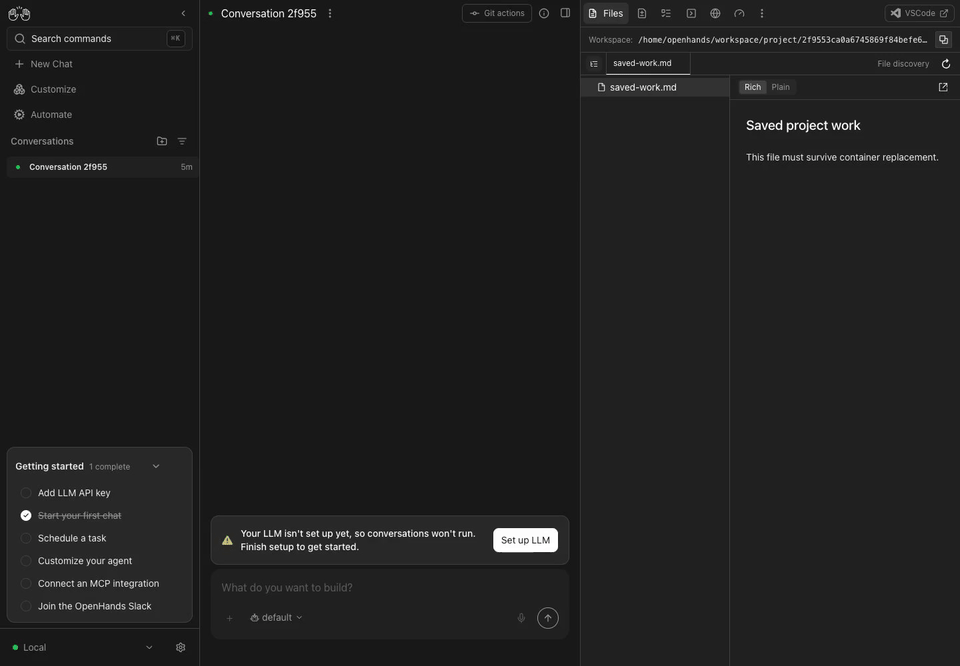

# Default workspace persistence: real Docker verification

Related issue: https://github.com/OpenHands/OpenHands/issues/18960

The default workspace is `/home/openhands/workspace/project/<conversation-id>`.
On unchanged main, this is outside both declared persistence volumes. Recreating
a container keeps the conversation record but loses its workspace files.

The proposed entrypoint change creates `~/workspace` as a symlink to
`~/.openhands/workspace` when no workspace directory or symlink already exists.
The standard state mount then retains default workspaces without changing the
frontend's workspace paths or placing generated directories among `/projects`.
Existing workspace directories, bind mounts and symlinks keep their current
location. This does not migrate an existing workspace directory or recover files
already lost with a removed container.

## Actual runtime setup

- Date: 2026-10-26, native macOS arm64 with Docker Linux arm64.
- Base commit: `d1baed36caf4cb4d541b6e46278807a6ecc4a010`.
- Both cases use the same released image:
  `ghcr.io/openhands/agent-canvas@sha256:49e2517eb14a133cb952e0575c24ec59db963ac096b404932f7a1bc9a12e666c`.
- Agent Server: 1.58.1. Automation: 1.25.1.
- The image's entrypoint is replaced by an executable, byte-identical copy of
  main's entrypoint for the baseline, or the proposed entrypoint for the fix.
  Both run as the image's `openhands` user (UID/GID 10001).
- Each case has its own named volume mounted at `/home/openhands/.openhands`.
  The container is removed, then recreated with the same volume and entrypoint.
  The before/after JSON files record different container IDs.
- A real idle conversation is created through `POST /api/conversations` with
  its default workspace path and no initial message. A fixture file
  `saved-work.md` is written in that workspace with `docker exec`.
  No model runs, model responses or backend responses are mocked.
- The browser opens the real Docker-served Canvas, opens Files and selects the
  fixture. After container recreation it reloads the same conversation and
  reopens Files. Recordings pause during container startup; the pause is cut.

## Observed results

| Case | Conversation after recreation | File API | File contents |
| --- | --- | --- | --- |
| Main | Still present, idle | 404 | Lost; Canvas reports `Failed to read saved-work.md: 404` |
| Proposed fix | Still present, idle | 200 | Retained with the original SHA-256 |

The retained SHA-256 is
`fc67f2cd31761beac2b601409bb4becc968fd32bf6e8f34b923d6f4ca53f2a29`.
Read the four `*-replacement.json` files for the file API and container readback.

Baseline:


Proposed fix:



## Regression and compatibility checks

The new tests execute the entrypoint's real persistence setup in temporary
container-home directories sharing one state directory. On unchanged main,
the retention and unavailable-storage cases fail, while the existing-workspace
controls pass. With the fix, all four pass on macOS and Linux.

```sh
npm test -- __tests__/scripts/docker-default-workspace.test.ts
```

- macOS: 45 scoped tests pass across the workspace, browser-tools and VS Code
  route suites.
- Linux arm64: all 75 scoped tests pass, including the automation KV-secret
  suite.
- Full macOS suite: 9,544 passed, 13 failed, 7 todo. The same 13 KV-secret tests
  fail on unchanged main because the local shell startup emits a missing
  `/.cargo/env` message. Their production block is unchanged by this patch.
- `npm run lint` passes with 0 errors and 417 existing warnings; the new test's
  ESLint and Prettier checks pass.
- `bash -n` and ShellCheck at warning severity pass. Default ShellCheck reports
  the same pre-existing SC2329 informational finding on main and the fix.
- The app build passes for the unchanged frontend source; `npm run build:lib`
  also passes. No frontend source or dependency files change.

## Manual reproduction

1. Run the documented Docker command with a persistent state mount.
2. Start a conversation without selecting a project workspace. Create or upload
   a file and open it in Canvas's Files panel.
3. Remove the container and run the same image with the same state mount.
4. Reopen the conversation and its Files panel. Main retains the conversation
   but loses the file. The proposed entrypoint retains both.

The storage approach still needs maintainer agreement in #18960 and the issue's
`ready-for-dev` label before opening the fixing PR.
